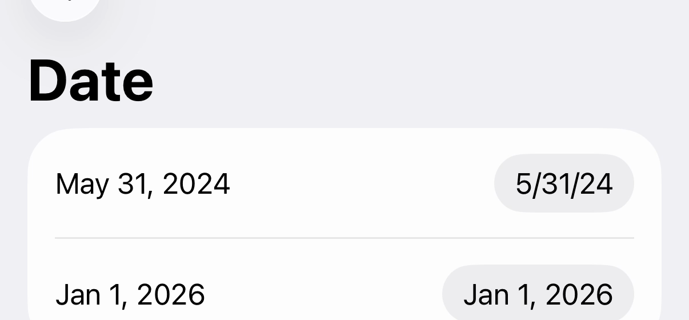

# SwiftUI compact `DatePicker` shows the short date format

A plain SwiftUI app. It has no third-party code.

A compact `DatePicker` shows the short date format (`5/31/24`) when its medium label (`May 31, 2024`) is wider than about 125pt. The row has enough space for the medium label.

[demo.mp4](demo.mp4)

## Steps

1. Open `DatePickerRepro.xcodeproj`.
2. Set the simulator or device region to United States (`en_US`).
3. Run the app.
4. Tap **Open date screen**.

## Result

| Row | Expected | Actual |
| --- | --- | --- |
| May 31, 2024 | `May 31, 2024` | `5/31/24` |
| Jan 1, 2026 | `Jan 1, 2026` | `Jan 1, 2026` |

The two pickers are the same. Only the date is different.

In this app, which uses a SwiftUI `NavigationStack`, the short format stays. When a `UIHostingController` is pushed by a `UINavigationController`, the picker shows the short format during the push and changes to the medium format when the push ends.

## Cause

A compact `UIDatePicker` reports a width of 125pt from `sizeThatFits` until it lays out in a window. The selected date does not change this value. After the first layout in a window, it reports the correct width.

| Selected date | `sizeThatFits` before the first layout in a window | After |
| --- | --- | --- |
| May 31, 2024 | 125.0 | 126.7 |
| Jan 1, 2026 | 125.0 | 112.0 |

SwiftUI measures the picker before that layout, so it gives the picker 125pt. The medium label does not fit in 125pt, so the picker shows the short format. Nothing makes SwiftUI measure the picker again.

## Workarounds that do not work

These were tested on the default `DatePicker`:

- `.id(date)`
- `.environment(\.locale, .current)`
- `.fixedSize()`
- `.frame(width: 140)`, `.frame(minWidth: 140)`, `.frame(minWidth: 280)`
- `.frame(maxWidth: .infinity, alignment: .trailing)`
- `.layoutPriority(1)`
- `.datePickerStyle(.compact)`

## Related reports

- [Apple Developer Forums 675191](https://developer.apple.com/forums/thread/675191) (2021)
- [Apple Developer Forums 675944](https://developer.apple.com/forums/thread/675944) (2021)
- [Stack Overflow 66090210](https://stackoverflow.com/questions/66090210/swiftui-datepicker-jumps-between-short-and-medium-date-formats-when-changing-the) (2021)
- [expo/expo#52491](https://github.com/expo/expo/issues/52491)

## Environment

- Xcode 27.1 (27A9269)
- iPhone 17 Pro simulator, iOS 26.5 (23F77)
- Region: United States (`en_US`)
